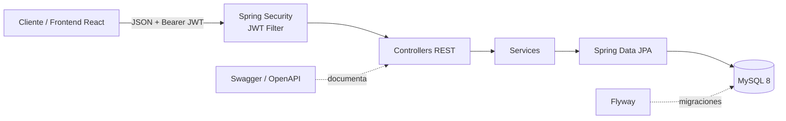
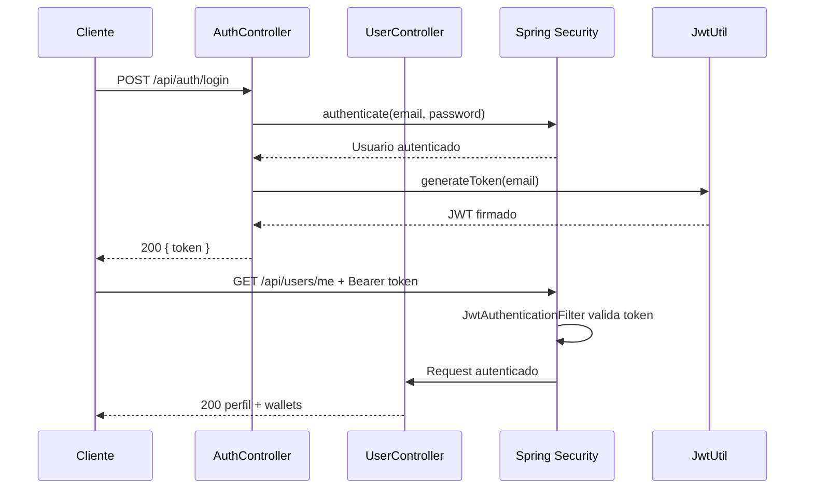
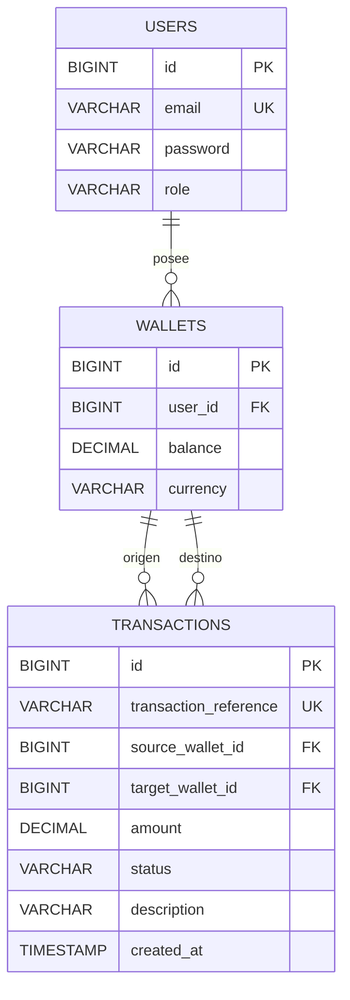

# Pasarela de Pagos — API Backend

API REST para una pasarela de pagos P2P. Permite registrar usuarios, autenticarse con JWT, consultar billeteras, transferir saldo por email y revisar el historial de movimientos.

El proyecto está construido con **Java 17**, **Spring Boot 4**, **Spring Security**, **Spring Data JPA**, **MySQL 8** y **Flyway**, con documentación interactiva mediante **Swagger / OpenAPI**.


> **Alcance del proyecto:** implementación de portafolio. Modela transferencias P2P internas entre usuarios; no procesa pagos reales ni integra proveedores externos.

---

## Descripción

La aplicación modela el flujo básico de una pasarela de pagos entre personas:

- Cada usuario tiene una billetera en **USD**.
- Las cuentas nuevas comienzan con saldo `0.00`.
- Una transferencia se envía al email de otro usuario.
- El origen se obtiene desde el JWT, nunca desde el body.
- El débito, el crédito y el registro del movimiento se ejecutan en una sola transacción de base de datos.
- Cada movimiento tiene una referencia UUID generada por el servidor.
- El historial se devuelve paginado y con la dirección `IN` / `OUT` calculada desde el punto de vista del usuario autenticado.

La API usa un contrato de errores uniforme con `code`, `message` y `fieldErrors`, lo que facilita el consumo desde un frontend.

## Funcionalidades

- Registro e inicio de sesión con JWT.
- Contraseñas hasheadas con BCrypt.
- Autorización por roles `USER` y `ADMIN`.
- Restricciones de acceso por propietario del recurso.
- CRUD de usuarios con reglas de administración.
- Consulta de perfil y billetera.
- Transferencias P2P por email.
- Validación de fondos, moneda, destinatario y auto-transferencia.
- Historial paginado de movimientos.
- Errores tipados y consistentes.
- Migraciones de base de datos con Flyway.
- Documentación Swagger con esquema Bearer JWT.
- Suite de 54 tests automatizados.

## Stack tecnológico

| Área | Tecnología |
|---|---|
| Lenguaje | Java 17 |
| Framework | Spring Boot 4.0.8, Spring Web MVC |
| Persistencia | Spring Data JPA, Hibernate, MySQL 8 |
| Seguridad | Spring Security, JWT (JJWT 0.12.5), BCrypt |
| Validación | Jakarta Bean Validation |
| Migraciones | Flyway |
| Documentación | springdoc OpenAPI, Swagger UI |
| Productividad | Lombok |
| Build | Maven Wrapper |
| Testing | JUnit 5, Mockito, MockMvc, Spring Security Test |
| Infraestructura local | Docker Compose, MySQL 8 |

## Arquitectura



La aplicación sigue una separación por capas:

| Capa | Responsabilidad |
|---|---|
| `controller` | Expone los endpoints HTTP, valida requests y define códigos de respuesta. |
| `service` | Contiene las reglas de negocio y delimita las transacciones. |
| `repository` | Acceso a datos mediante Spring Data JPA. |
| `model` | Entidades JPA del dominio. |
| `dto` | Contratos de entrada y salida; evita exponer entidades directamente. |
| `security` | Autenticación, JWT, `UserDetailsService` y respuestas 401/403. |
| `exception` | Excepciones de negocio y manejo global de errores. |
| `config` | Seguridad, CORS, JWT y configuración de OpenAPI. |

## Seguridad

- La API es **stateless**: no usa sesiones HTTP.
- `POST /api/auth/register` y `POST /api/auth/login` son públicos.
- El login delega en `AuthenticationManager` y devuelve un JWT firmado.
- El filtro `JwtAuthenticationFilter` lee `Authorization: Bearer <token>`, valida la firma y carga el usuario en el `SecurityContext`.
- Las contraseñas se almacenan con `BCryptPasswordEncoder`.
- Los roles se normalizan internamente a `ROLE_USER` / `ROLE_ADMIN` para Spring Security.
- `@EnableMethodSecurity` permite reglas como `hasRole('ADMIN')` y acceso de propietario.
- Los errores de autenticación y autorización también respetan el contrato JSON de la API.

### Flujo de autenticación



## Modelo de datos



Notas del modelo:

- `users.email` es único.
- La fase actual crea una billetera `USD` por usuario; el modelo permite más de una.
- Los saldos y montos usan `DECIMAL(15,2)` y `BigDecimal` para evitar errores de punto flotante.
- Las transferencias guardan referencias a las billeteras de origen y destino.
- Flyway administra el esquema mediante las migraciones `V1` a `V3`.

## API

- **Base URL local:** `http://localhost:8080`
- **Swagger UI:** `http://localhost:8080/swagger-ui.html`
- **OpenAPI JSON:** `http://localhost:8080/v3/api-docs`
- **Autenticación:** `Authorization: Bearer <token>`

### Endpoints

| Método | Ruta | Acceso | Descripción |
|---|---|---|---|
| `POST` | `/api/auth/register` | Público | Registra un usuario y devuelve un JWT. |
| `POST` | `/api/auth/login` | Público | Inicia sesión y devuelve un JWT. |
| `GET` | `/api/users/me` | Autenticado | Perfil del usuario autenticado. |
| `GET` | `/api/users/{id}` | Dueño o `ADMIN` | Usuario por ID. |
| `GET` | `/api/users` | `ADMIN` | Lista de usuarios. |
| `POST` | `/api/users` | `ADMIN` | Crea un usuario. |
| `PUT` | `/api/users/{id}` | Dueño o `ADMIN` | Actualiza email y, opcionalmente, contraseña. |
| `DELETE` | `/api/users/{id}` | `ADMIN` | Elimina un usuario. |
| `GET` | `/api/wallets/me` | Autenticado | Billetera del usuario autenticado. |
| `GET` | `/api/wallets/users/{id}` | Dueño o `ADMIN` | Billetera de un usuario. |
| `POST` | `/api/transactions` | Autenticado | Transfiere saldo a un email. |
| `GET` | `/api/transactions/me` | Autenticado | Historial paginado del usuario. |

### Ejemplo: transferencia

```http
POST /api/transactions
Authorization: Bearer <token>
Content-Type: application/json

{
  "targetEmail": "bob@demo.com",
  "amount": 25.50,
  "description": "Pago de la cena"
}
```

Respuesta `201 Created`:

```json
{
  "id": 12,
  "reference": "6c1f2f4e-8f83-4b1d-9f0f-5a3f0d9f1c22",
  "amount": 25.50,
  "currency": "USD",
  "status": "SUCCESS",
  "direction": "OUT",
  "sourceWalletId": 4,
  "targetWalletId": 5,
  "counterpartyEmail": "bob@demo.com",
  "description": "Pago de la cena",
  "createdAt": "2026-11-11T12:56:00"
}
```

Reglas de una transferencia:

1. El usuario autenticado debe tener una billetera.
2. El destinatario se resuelve por email.
3. No se permite transferirse a uno mismo.
4. Ambas billeteras deben tener la misma moneda.
5. La billetera de origen debe tener fondos suficientes.
6. El débito, el crédito y el registro se ejecutan con `@Transactional`.
7. La referencia se genera como UUID y el estado inicial es `SUCCESS`.

### Historial paginado

```http
GET /api/transactions/me?page=0&size=10&sort=createdAt,desc
```

La respuesta usa un wrapper propio:

```json
{
  "content": [],
  "page": 0,
  "size": 10,
  "totalElements": 0,
  "totalPages": 0
}
```

El tamaño máximo de página es `50`.

## Contrato de errores

Todos los errores usan la misma estructura:

```json
{
  "timestamp": "2026-11-11T12:56:00",
  "status": 400,
  "error": "Bad Request",
  "code": "VALIDATION_ERROR",
  "message": "La solicitud contiene errores de validación",
  "fieldErrors": {
    "amount": "El monto debe ser mayor que cero"
  }
}
```

`fieldErrors` siempre está presente. Es `{}` cuando el error no está asociado a campos de formulario.

| Código | HTTP | Uso |
|---|---:|---|
| `VALIDATION_ERROR` | 400 | Body o parámetros inválidos; incluye `fieldErrors`. |
| `BAD_REQUEST` | 400 | JSON mal formado o tipo de parámetro incorrecto. |
| `BUSINESS_ERROR` | 400 | Regla de negocio incumplida. |
| `UNAUTHORIZED` | 401 | Token ausente, inválido o credenciales incorrectas. |
| `FORBIDDEN` | 403 | El usuario no tiene permisos. |
| `RESOURCE_NOT_FOUND` | 404 | Recurso inexistente. |
| `CONFLICT` | 409 | Email duplicado u otro conflicto de datos. |
| `INTERNAL_ERROR` | 500 | Error no controlado. |

## Puesta en marcha

### Requisitos

- JDK 17
- Docker Desktop
- No es necesario instalar Maven: se incluye Maven Wrapper

### 1. Levantar MySQL

```bash
docker compose up -d
```

El contenedor `pasarela_mysql` expone MySQL en `localhost:3307` y crea la base `pasarela_db`.

### 2. Ejecutar la API

En Windows:

```powershell
.\mvnw.cmd spring-boot:run
```

En macOS/Linux:

```bash
./mvnw spring-boot:run
```

La API queda disponible en `http://localhost:8080`.

### 3. Abrir Swagger

```text
http://localhost:8080/swagger-ui.html
```

Desde Swagger se pueden probar los endpoints y configurar el token con el botón **Authorize**.

### Detener o reiniciar la base

```bash
docker compose down
```

Para borrar también los datos y volver a aplicar las migraciones desde cero:

```bash
docker compose down -v
docker compose up -d
```

## Variables de entorno

| Variable | Valor por defecto | Uso |
|---|---|---|
| `DB_URL` | `jdbc:mysql://localhost:3307/pasarela_db?useSSL=false&serverTimezone=UTC&allowPublicKeyRetrieval=true` | URL JDBC de MySQL. |
| `DB_USER` | `root` | Usuario de la base. |
| `DB_PASSWORD` | `root` | Contraseña de la base. |
| `JWT_SECRET` | Secreto de desarrollo | Firma de los JWT; debe tener al menos 32 caracteres en producción. |
| `JWT_EXPIRATION_MS` | `36000000` | Expiración del token; 10 horas por defecto. |
| `CORS_ALLOWED_ORIGINS` | `http://localhost:3000,http://localhost:4200,http://localhost:5173` | Orígenes permitidos, separados por coma. |
| `MYSQL_DATABASE` | `pasarela_db` | Base creada por Docker Compose. |
| `MYSQL_ROOT_PASSWORD` | `root` | Contraseña root del contenedor MySQL. |
| `MYSQL_PORT` | `3307` | Puerto host de MySQL. |

En producción se deben definir `JWT_SECRET`, `DB_*` y `CORS_ALLOWED_ORIGINS` con valores propios del entorno.

## Probar una transferencia

1. Registra dos usuarios desde Swagger, por ejemplo `alice@demo.com` y `bob@demo.com`.
2. Guarda el token devuelto por el registro o por el login.
3. Como las cuentas nuevas nacen con `0.00`, fondea una billetera localmente para probar:

```sql
UPDATE wallets
SET balance = 100.00
WHERE user_id = (SELECT id FROM users WHERE email = 'alice@demo.com');
```

4. Con el token de `alice`, llama a `POST /api/transactions` con el email de `bob`.
5. Consulta `GET /api/transactions/me` para ver el movimiento `OUT`.
6. Repite el historial con el token de `bob` para ver el movimiento `IN`.

La Fase 2 incorporará un seed de usuarios demo y un mecanismo de reset para probar este flujo sin intervención manual.

## Tests

```powershell
# Windows
.\mvnw.cmd test
```

```bash
# macOS / Linux
./mvnw test
```

La suite cubre:

- Contexto de Spring Boot y exposición de Swagger.
- Seguridad: autenticación, autorización y JWT.
- Controllers con MockMvc.
- Servicios y reglas de negocio.
- Validación de DTOs.
- Manejo global de excepciones.
- Entidad `User` y conversión de roles.
- Respuestas 401/403.

**Estado actual: 54 tests pasando.** El test de contexto requiere que MySQL esté disponible en `localhost:3307`.

## Estructura del proyecto

```text
src/main/java/jro/pry/PasarelaPagos
├── config/       # SecurityConfig, JwtUtil, JwtAuthenticationFilter, OpenApiConfig
├── controller/   # Auth, User, Wallet y Transaction controllers
├── dto/          # Requests, responses, paginación y contrato de errores
├── exception/    # Excepciones de negocio y GlobalExceptionHandler
├── model/        # Entidades JPA: User, Wallet, Transaction
├── repository/   # Repositorios Spring Data JPA
├── security/     # UserDetailsService y handlers REST 401/403
└── service/      # Reglas de negocio y transacciones

src/main/resources
├── application.yml
└── db/migration/ # V1, V2 y V3
```

## Decisiones de diseño

- **JWT stateless** para no depender de sesiones y facilitar el consumo desde el frontend.
- **BCrypt** para almacenar contraseñas, nunca texto plano.
- **DTOs** para separar el contrato HTTP de las entidades JPA.
- **`BigDecimal` y `DECIMAL(15,2)`** para representar dinero sin errores de precisión.
- **`@Transactional`** para que una transferencia sea atómica.
- **Flyway** para que el esquema sea reproducible entre entornos.
- **Errores tipados** para que el frontend pueda reaccionar por `code` y mostrar `fieldErrors`.
- **`open-in-view: false`** para evitar consultas perezosas implícitas fuera de la capa de servicio.
- **Paginación acotada** a un máximo de 50 elementos por página.
- **`EntityGraph`** para cargar las billeteras del usuario de forma explícita y evitar N+1.

## Estado y roadmap

### Mejoras futuras

- Refresh tokens y revocación.
- Idempotencia en transferencias.
- Rate limiting.
- Testcontainers para integración con MySQL.
- Pipeline CI/CD.
- Imagen Docker de la API.
- Observabilidad y métricas.
- Soporte para múltiples monedas y comisiones.

## Frontend

El frontend de la pasarela está construido con React 19, TypeScript y Tailwind CSS, y consume esta API mediante JWT. Se mantiene en un repositorio separado.

En desarrollo, el backend permite CORS desde `http://localhost:5173`, que es el origen por defecto de Vite.

---

Proyecto desarrollado como parte de un portafolio de desarrollo backend.
